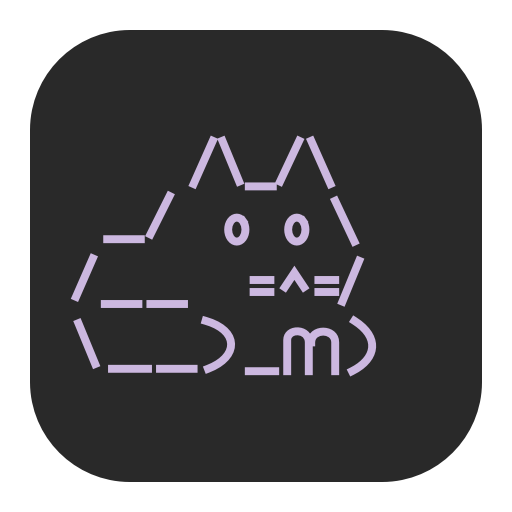

# Lightpaw



小而美的 macOS 本地维护工具。原生 SwiftUI / AppKit 界面，深灰、灰白与淡紫配色，一只会眨眼、摆尾的字符小猫。

Lightpaw 将 [Mole](https://github.com/tw93/Mole) 的常用能力、Homebrew 应用管理与 Codex 内存观察整合在一个窗口和菜单栏面板中。当前版本 **4.4.0 · build 25**。这是独立项目，并非 Mole、Homebrew 或 OpenAI 的官方客户端。

## 能做什么

| 入口 | 功能 |
| --- | --- |
| 总览 | Mole 健康评分、CPU、内存压力、磁盘、电池与 Codex 趋势。 |
| 清理 | 扫描、搜索、逐项勾选、检查清单；默认移到废纸篓。 |
| 应用 | 查看 Homebrew cask、检查更新、单项更新和卸载；复杂脚本先审阅，需要权限时使用原生密码窗口。 |
| Codex | 每 10 秒观察进程树物理内存、系统压力与进程变化；逐项管理经核实的后台工具自动加载。 |
| 磁盘 | 只读浏览目录占用，在 Finder 中定位。 |
| 更多 | 系统维护预览、确认执行与操作历史。 |

菜单栏小猫可查看状态、刷新、启动或取消清理扫描，并进入主窗口逐项选择。关闭窗口后保留菜单栏与 Codex 采样；`⌘Q` 才会退出。小猫动画在窗口不可见或开启“减少动态效果”时暂停。

## 运行条件

- macOS 13 或更高版本；实际验证环境为 Apple Silicon。当前没有 Windows 版本。
- 构建需要 Xcode Command Line Tools，以及 `swiftc`、`clang`、`codesign`。
- Mole 维护写入仅支持已核对的 **1.61.0**，入口固定为 `/opt/homebrew/bin/mo`；不会自动安装、升级或降级 Mole。其他版本的维护写入会被阻止。
- Homebrew 功能管理 **cask 应用**，不提供 formula 包管理；缺少依赖时对应能力不可用。
- Codex 监测会核对受支持位置中的应用身份。插件清单读取当前依赖 `/Applications/ChatGPT.app` 内置的 Codex CLI 路径；其他安装布局可能无法管理插件。后台工具管理需要可核验的本地配置及清单。

## 构建与运行

```sh
git clone https://github.com/yxflc11/Lightpaw.git
cd Lightpaw
./build.sh
./dist/Lightpaw.app/Contents/MacOS/CodexMemoryWatch --self-test
open dist/Lightpaw.app
```

构建生成 `dist/Lightpaw.app`，包含图标、进程桥 `MoleGuardian` 与授权助手 `MacCareAskpass`，不需要下载项目依赖。构建只生成应用，不自动安装、启动或执行维护。可将生成的应用放入 `~/Applications` 使用。

当前使用本机 ad-hoc 签名，未提供 Developer ID 签名、公证或面向其他电脑的安装包。云同步目录可能附加影响签名的扩展属性；遇到签名问题时，请在本机非同步目录重新构建。

只读单次采样：

```sh
./dist/Lightpaw.app/Contents/MacOS/CodexMemoryWatch --sample-once
```

## 操作边界

清理和卸载先检查清单再确认，不自动执行扫描结果。默认清理移到废纸篓；清空废纸篓后才释放空间。Homebrew 卸载不使用 `--zap` / `--force`，不自动移除依赖，但也不保证可从废纸篓恢复。复杂 cask 脚本不能仅靠声明清单穷举影响，来源无法核实时会阻止执行。

后台工具开关保存的是**下次加载设置**：待应用的更改可撤销，并会在重启 Lightpaw 后保留。保持 Lightpaw 运行，待连续确认本机 Codex 主程序与命令行引擎均退出后，才核对并写入配置、保留备份。不会强制结束现有工具连接，也不会为了生效而退出 Codex。内置共享工具、账号托管连接及来源不明的工具保持只读。

内存页面提供观察与提示，不是内存上限，不冻结进程，也不保证阻止 Codex 崩溃。完整范围见 [行为与边界](docs/BEHAVIOR.md)。

## 隐私与验证

Codex 采样不发送网络请求，日志只记录进程基名、PID、内存和压力等指标，不记录对话、完整命令行或环境变量。日志保存在本机，限制为最近 7 个日历日且总计不超过 20 MiB。Homebrew 检查更新会明确刷新配方并访问网络；Mole 输出可能包含本机路径。

仓库包含源码、图标、构建脚本与隔离夹具测试；本机日志、配置、诊断记录、编译缓存和个人环境专用验收入口不纳入版本管理。已验证范围与未覆盖环节见 [验证说明](docs/VALIDATION.md)，界面与生命周期约定见 [设计说明](DESIGN.md)。

## 目录

```text
Sources/       原生界面、监测、清理、Homebrew 与后台工具管理
Resources/     字符猫应用图标
Scripts/       原生图标生成器
Tests/         自动化测试与隔离夹具
docs/          行为边界与验证说明
build.sh       本机编译与签名
```

Mole 和 Homebrew 作为外部安装工具调用，不随仓库分发。当前未指定开源许可证。
